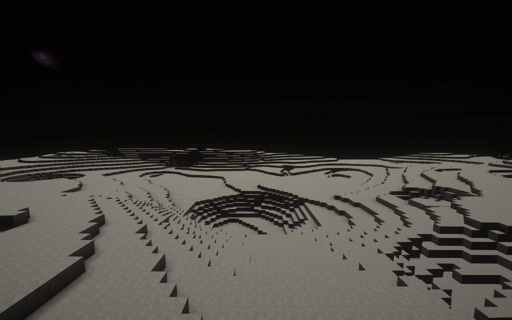
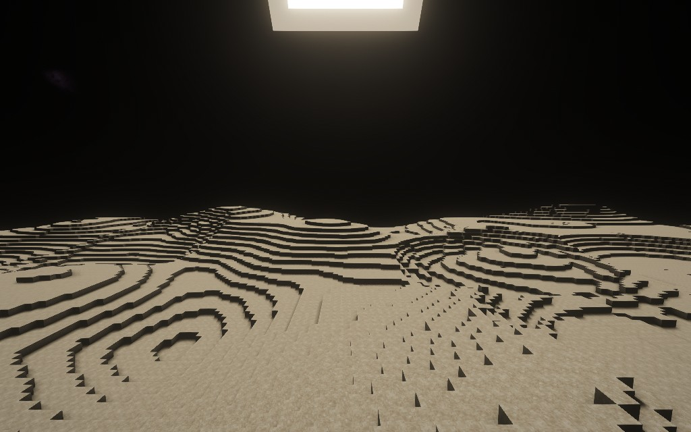
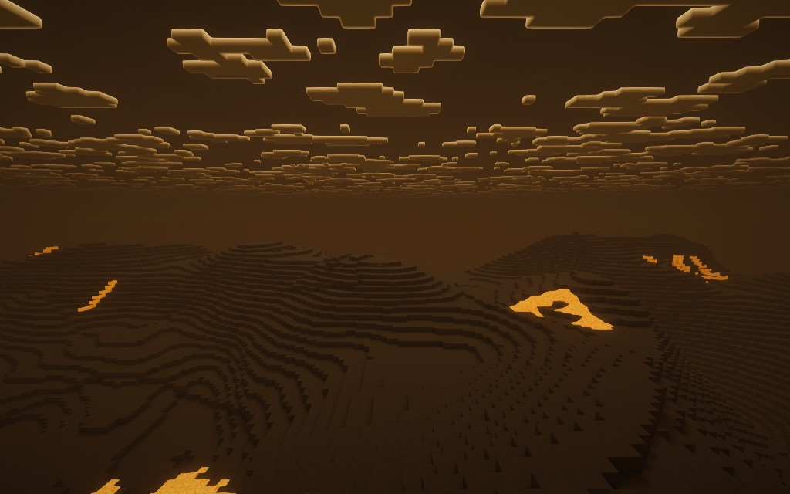
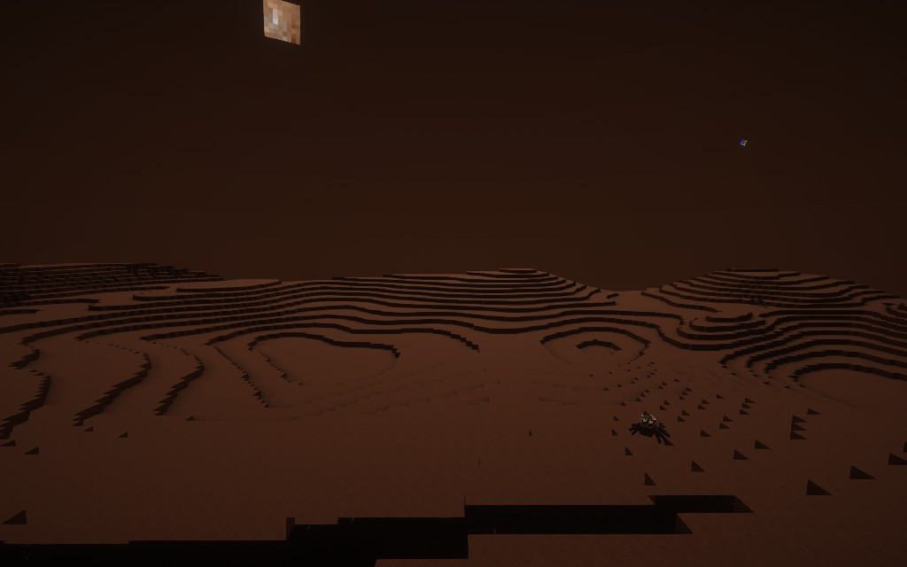

# GalacticShaders

Client-side planetary lighting for Galacticraft and its addons in GT New Horizons 2.9.0.

## Installation

Install GalacticShaders in your client mods folder and one supported shader pack in shaderpacks: Complementary Reimagined r5.9.3, BSL v10.1.8, or Photon v1.4. Select its GalacticShaders copy in Angelica.

## Planet lighting

| Moon | Mercury |
| --- | --- |
|  |  |
| Airless sky and deep shadows | Strong sunlight against a black sky |

| Venus | Mars |
| --- | --- |
|  |  |
| Dense clouds diffuse sunlight | Dust gives the daylight sky a red tint |

Clear outer worlds show daytime stars. Pluto receives enough daylight to distinguish ridges while their shaded faces stay dark.

## AI disclosure

This mod was mostly written with AI. If that's not your thing, don't use it. Despite that, the mod works, and is maintained. If you find any bugs, or visual glitches, or have any suggestions, then please tell about them in the issues page!

## Build

Run build.ps1 with JDK 17 or newer. Pass -Classpath with the Forge 1.7.10 development JAR, Galacticraft, Angelica, LaunchWrapper and ASM. The script produces a Java 8 client JAR.
